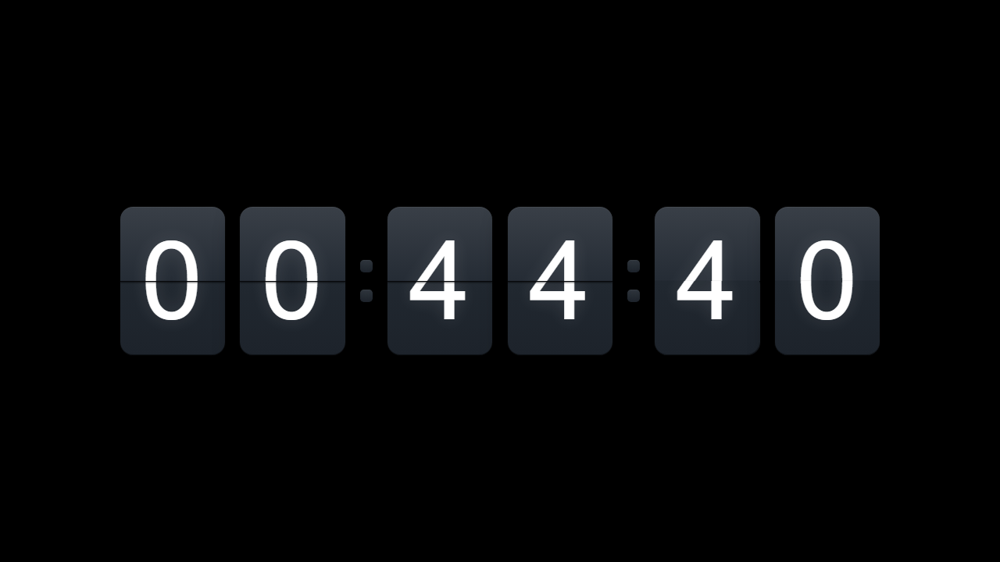
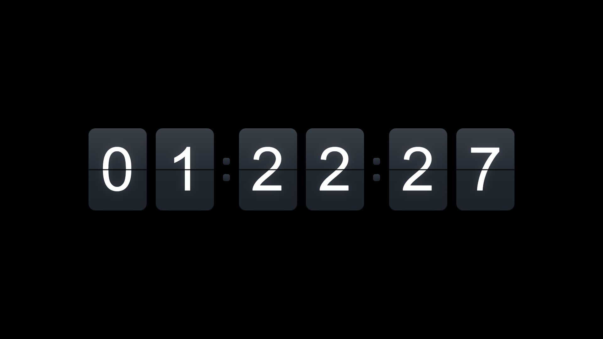
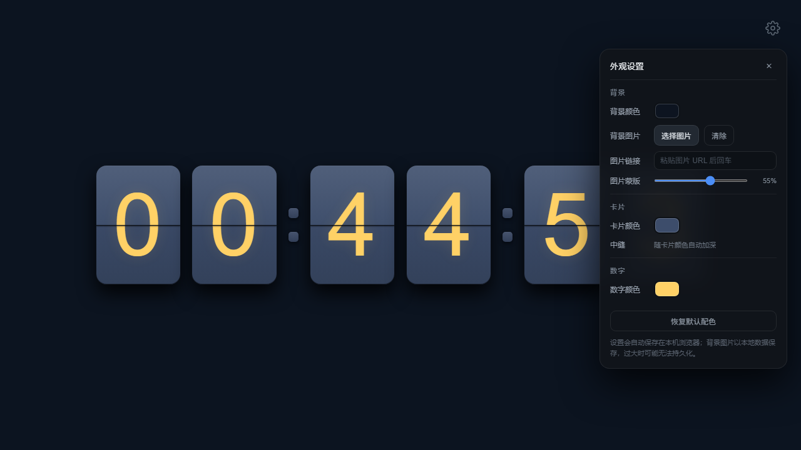
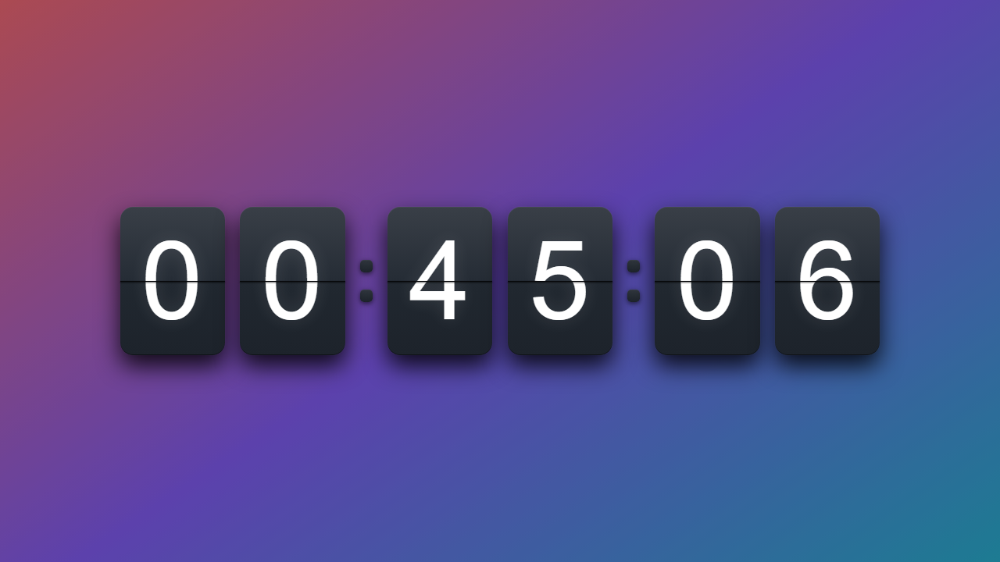
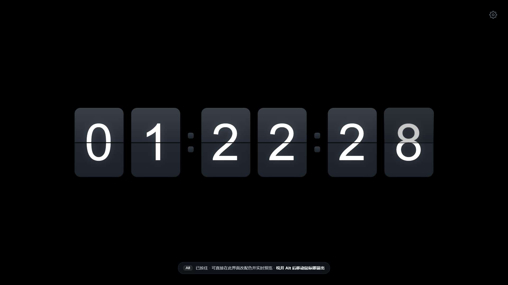
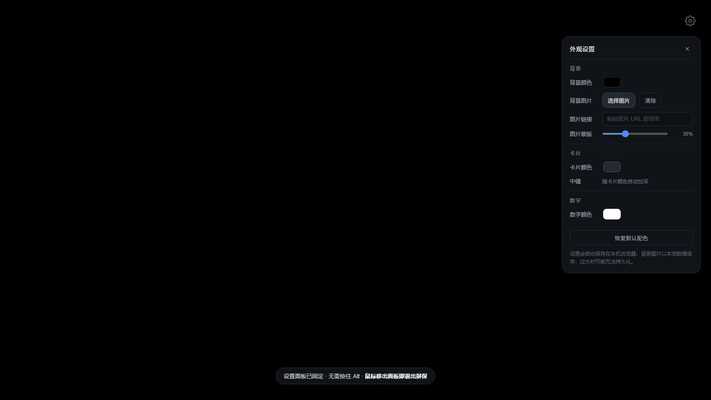

# Flip Clock · 翻页时钟屏保

一个 Windows 上的**全屏翻页时钟**，带**系统级空闲屏保**功能：电脑空闲到设定时间，
自动全屏跳出翻页时钟；动一下鼠标或键盘就淡出回桌面。

纯 Python 标准库 + 单文件网页，**零第三方依赖**，不需要 `pip install` 任何东西。

> ⚠️ 仅支持 **Windows**（依赖 `GetLastInputInfo` / `SetWindowPos` 等 Win32 API）。

---

## 效果预览

| 默认效果 | 全屏跳出 |
| --- | --- |
|  |  |

| 设置面板（改配色 / 空闲时长） | 背景图片 + 蒙版 |
| --- | --- |
|  |  |

| 屏保内按住 Alt 出现齿轮与提示条 | 屏保内直接改配色（松开 Alt 也不退） |
| --- | --- |
|  |  |

---

## 特性

**时钟本身**

- 真 3D 翻页动画（`perspective` + `preserve-3d`，四层卡片结构：上下静片 + 上下翻页片）
- `HH:MM:SS` 六位数字 + 两个常亮冒号，细字重等宽数字
- 配色可调：背景（纯色 / 本地图片 / 图片 URL + 蒙版）、卡片、数字
- 背景图与卡片明暗、冒号、中缝全部由一个基色自动推导

**空闲屏保**

- 用 `GetLastInputInfo` 读**系统级**空闲时间，任意鼠标/键盘输入都会重置
- 到点自动全屏跳出；有输入立刻淡出（先淡出、再隐藏窗口，不会硬切）
- 全屏采用 `msedge --kiosk`，**真·无边框**：没有标题栏、最小化/关闭按钮，也没有白边
- 跳出时自动隐藏鼠标指针，动一下鼠标临时显示
- 支持多屏选择：鼠标所在屏幕 / 主屏幕 / 全部屏幕

**两种模式**

| 模式 | 说明 |
| --- | --- |
| **屏保模式** | 空闲到点自动跳出（默认 10 分钟），有输入自动退出 |
| **手动模式** | 立即全屏显示，不监控空闲、不因鼠标移动退出，按 `Esc` 退出 |

**屏保界面里还能改设置**：屏保全屏时按住 `Alt`，右上角出现齿轮 →
点开设置面板后**可以松开 `Alt`**，只要鼠标还在面板内屏保就不退出，改配色能实时预览；
鼠标移出面板即刻退出。

**安全**：本地 HTTP 控制通道加了 Host / Origin 白名单、运行期 token 鉴权、
静态文件白名单、请求体上限（详见 [docs/README.md](docs/README.md#安全边界本机服务只服务于本机页面)）。

---

## 环境要求

- Windows 10 / 11
- Python 3（[python.org](https://www.python.org/downloads/) 安装时勾选 *Add python.exe to PATH*）
- Microsoft Edge 或 Google Chrome（自动探测常见安装路径）

---

## 快速开始

1. 下载或克隆本仓库
   ```bat
   git clone https://github.com/2672254297-dot/flip-clock.git
   ```
2. 双击 **`start.bat`** 启动屏保宿主（想后台无窗口运行就用 `start-silent.vbs`）
   - 控制台会打印设置页地址、空闲阈值、窗口模式；
   - 首次启动会在后台预热一个全屏窗口（藏在屏幕外），所以第一次会花十几秒。
3. 双击 **`settings.bat`** 打开设置页，调整配色、空闲时长、显示屏幕。
4. 之后就不用管了：空闲到点自动跳出，一动鼠标/键盘立刻淡出。

**只想现在就看看效果**：双击 **`clock.bat`** —— 立即全屏显示，按 `Esc` 退出。

**想开机自启**：按 `Win+R` 输入 `shell:startup`，把 `start-silent.vbs` 的**快捷方式**放进去。

**停止**：双击 **`stop.bat`**；想顺带清掉浏览器缓存就用 **`clean.bat`**。

---

## 命令行参数

```
python app\flipclock_overlay.py [选项]

--manual             手动模式：立即全屏显示，不监听空闲、不自动退出（Esc 退出）
--idle-seconds S     按秒设置空闲阈值（临时覆盖，不写入 config.json）
--idle-minutes N     按分钟设置空闲阈值（覆盖 config.json）
--monitor MODE       cursor（鼠标所在屏幕，默认）| primary | all
--window-mode MODE   kiosk（默认，真·无边框全屏）| app（普通应用窗口，备用）
--keep-browser       常驻预热浏览器（默认，跳出 0 延迟）
--on-demand          按需启动：平时不占内存，退出即彻底结束浏览器
--port N             本地服务端口（默认 8756，被占用自动顺延）
--browser PATH       指定浏览器可执行文件路径
--no-browser         只跑本地服务，不启动时钟窗口（调试用）
--dry-run            只跑状态机，不真的显示/隐藏窗口（调试用）
--no-hide-cursor     全屏时不隐藏鼠标指针
--print-url          打印（带本次 token 的）设置页地址后退出
--stop               停止正在运行的实例并清理时钟浏览器
```

`app/config.json` 字段与之一一对应，首次启动自动生成：

```json
{
  "enabled": true,          // 总开关
  "idleSeconds": 600,       // 空闲阈值（秒）；>0 时以它为准
  "idleMinutes": 10,        // 旧字段，仅当 idleSeconds<=0 时回退
  "monitor": "cursor",      // cursor | primary | all
  "port": 8756,
  "browser": "",            // 留空 = 自动找 Edge / Chrome
  "windowMode": "kiosk",    // kiosk | app
  "keepBrowser": true,      // true = 常驻预热；false = 按需启动
  "prewarmSeconds": 20      // 按需启动时提前多少秒拉起浏览器
}
```

---

## 目录结构

```
flip-clock\
├── README.md            本文件（GitHub 落地页）
├── LICENSE              MIT
├── 启动指南.md          上手速查（启动 / 测试 / 排错）
├── start.bat            启动项：屏保模式（带日志窗口）
├── start-silent.vbs     启动项：屏保模式（后台无窗口）
├── clock.bat            启动项：手动模式（立即全屏）
├── clock-silent.vbs     启动项：手动模式（后台无窗口）
├── settings.bat         启动项：打开设置页
├── stop.bat             结束项：停止服务
├── clean.bat            结束项：停止服务并清缓存
├── app\                 程序本体
│   ├── flipclock_overlay.py   入口：CLI + 再导出
│   ├── flipclock_app.py       状态机 App（空闲判定 / 显示隐藏 / 保持 / 指针）
│   ├── flipclock_http.py      本地 HTTP 控制接口 + 端口工具
│   ├── flipclock_config.py    config / theme / runtime 读写（原子写）
│   ├── flipclock_win32.py     Win32 封装（窗口 / DPI / 光标 / 空闲 / 进程）
│   ├── flipclock_browser.py   浏览器进程查找与清理
│   ├── flipclock_common.py    路径、常量、日志
│   ├── index.html             时钟本体（HTML/CSS/JS 单文件）
│   ├── config.json            运行参数（自动生成）
│   └── theme.json             配色（自动生成）
├── docs\                详细文档与代码审查报告
├── previews\            效果截图
└── tests\               端到端自测（selftest.py）+ 30 秒测试脚本
```

**不要单独移动 `app\` 里的文件**——移动后要同步修改根目录启动脚本里的 `app\flipclock_overlay.py` 路径。

---

## 自测

`tests\selftest.py` 是一套端到端自测，会**真的把屏保全屏跳出来**并逐项断言
（全屏铺满 / 置顶 / 无白边 / 指针隐藏 / 有输入就退出 / 面板保持 / 安全回归 / 接口协议……），
共 **11 个阶段 144 项**：

```bat
python tests\selftest.py            :: 冷启动 + 完整回归
python tests\selftest.py --warm     :: 保留浏览器 profile，启动更快
python tests\selftest.py --no-shot  :: 不截图
```

它会自动还原 `config.json`，并把截图与宿主日志留在 `tests\` 下。
只想快速验证「空闲 30 秒跳出」可以用 `tests\test-30s.bat`。

---

## 已知限制

- **不是真正的 `.scr` 屏保程序**：本质是一个 kiosk 浏览器窗口 + Python 宿主，
  任务管理器里能看到 `msedge.exe`（用项目专属 profile，与你自己的浏览器完全隔离）。
- 屏保**不锁定**电脑，也不做密码保护，只负责显示。
- 空闲判定是系统级的，所以在别的程序里动鼠标也会退出——这是刻意设计。
- 淡入淡出靠页面透明度实现（Windows 不支持窗口级逐像素透明），
  所以时序是「页面先淡出 → 宿主再隐藏窗口」。
- `monitor: all` 是把窗口铺满整个虚拟桌面（跨屏一张大画面），不是每块屏各一份时钟。

---

## 开源协议

[MIT](LICENSE) © 2026 Liu
